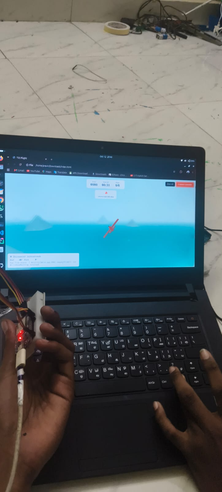

# tiny-board-is-flying-that-plane 

> I tilt a small board in my hand, and a plane flies on my laptop screen.



'm Pravin Kumar K, a second-year B.Sc. Electronics with Artificial Intelligence student in Chennai. I build things with ESP32s, sensors and a browser, and this is one of them: a **tilt-controlled flight game**. An **ESP32** reads an **MPU6050** motion sensor, streams the tilt over USB, and a web page turns it into flying.

## Why I built it

I saw a reel from [@schematikio](https://www.instagram.com/schematikio/) showing a homemade flight controller with an ESP32-C6 and a 3D plane game. I already had an ESP32 DevKit and an MPU6050 on my desk, so I thought: *why not build my own version, with two parts that work together, hardware and a website?*

This is that version. It took me a few evenings, and a lot of "device or resource busy" errors (see [Troubleshooting](#troubleshooting)).

## What you need

| Part | What it does |
|---|---|
| ESP32 DevKit | The brain. Reads the sensor and sends data over USB |
| MPU6050 | Accelerometer + gyroscope. Senses how I tilt the board |
| 4 jumper wires | SDA, SCL, 3V3, GND |
| USB cable (data, not charge-only) | Power + serial data to the laptop |
| Laptop with Chrome or Edge | Runs the game using the Web Serial API |

## Wiring

| MPU6050 | ESP32 |
|---|---|
| VCC | 3V3 |
| GND | GND |
| SDA | GPIO21 |
| SCL | GPIO22 |

## How it works

```
MPU6050 --I2C--> ESP32 --USB serial "roll,pitch"--> Chrome (Web Serial) --> Three.js game
 tilt             filter     50 times a second        reads the lines        plane banks/climbs
```

1. The ESP32 reads accelerometer and gyro values over I2C.
2. A **complementary filter** (96% gyro, 4% accelerometer) gives a stable roll and pitch.
3. It prints `roll,pitch` as a line of text 50 times a second.
4. The web page reads those lines with the **Web Serial API**: no app, no driver, no library.
5. **Three.js** turns roll into banking and turning, and pitch into climbing and diving.

The page also has a self-check panel: a green dot means the board is sending data, and red tells you what is wrong.

## Run it

```bash
git clone https://github.com/solo-prince/tiny-board-is-flying-that-plane.git
cd tiny-board-is-flying-that-plane
pio run -t upload          # flash the ESP32 (PlatformIO)
```

Then open `index.html` in **Chrome or Edge**:

1. Lay the board flat and still.
2. Click **Connect controller** and choose the ESP32's serial port.
3. Wait for the green dot, then click **Zero tilt** and **Start flying**.

Fly through all **8 rings** in **2 minutes**. The arrow at the top points to the next ring. No board yet? The arrow keys also work.

If left/right or up/down feels reversed, change `INVERT_ROLL` or `INVERT_PITCH` to `-1` at the top of the script in `index.html`.

## Troubleshooting

Things that actually went wrong for me on Ubuntu:

- **`Device or resource busy`**: another program holds the port. Close `pio device monitor` and the Arduino Serial Monitor, run `sudo systemctl stop ModemManager`, then `sudo fuser -k /dev/ttyUSB0`.
- **Permission denied**: `sudo usermod -aG dialout $USER` (log out and in), or `sudo chmod 666 /dev/ttyUSB0` for the current session.
- **Page says "Keyboard mode"**: the board isn't connected. Read the status panel at the bottom left; it says why.
- **`ERR,MPU6050 not found`** in the serial output: check SDA, SCL, 3V3 and GND wiring.

## What I learned

- How an IMU is read over I2C and why one sensor alone is noisy (the complementary filter fixes that).
- The browser can talk to hardware directly with Web Serial, so no backend is needed.
- Most hardware bugs are cables, ports and permissions, not code.

## Ideas for next time

- Wireless control over BLE
- A throttle using a potentiometer or a button
- Score saving and a leaderboard

## Credits

Inspired by [@schematikio](https://www.instagram.com/schematikio/)'s ESP32-C6 flight controller reel. Game built with [Three.js](https://threejs.org/).

## Author

**Pravin** · [github.com/solo-prince](https://github.com/solo-prince)

If you build your own version, I'd love to see it. Open an issue or tag me.
